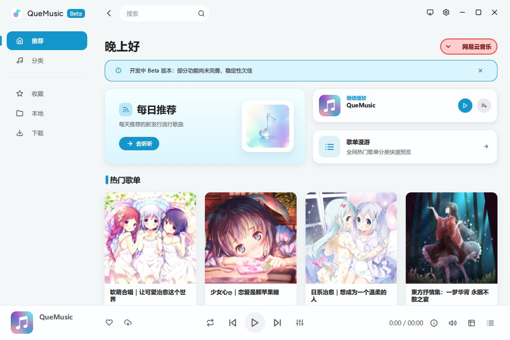
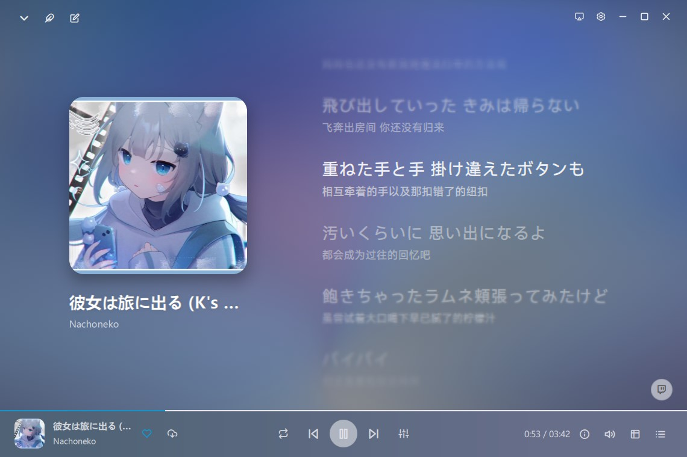
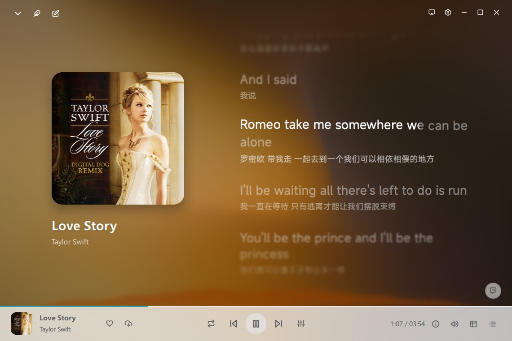
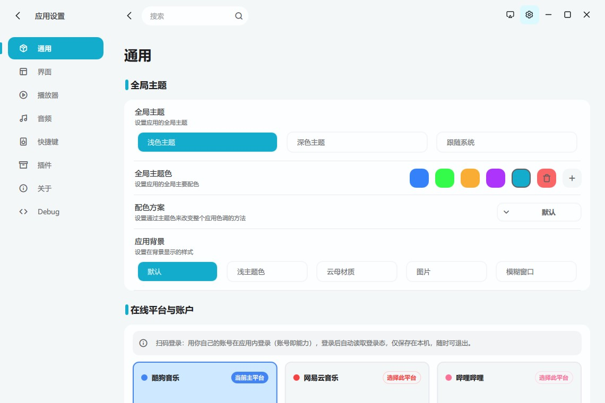

# QueMusic Project

<p align="center"></p>

<p align="center"><b>基于 QtQuick 框架开发的现代高性能跨平台音乐播放器</b></p>

<p align="center">
  
  
  
  
  
  
  
  
</p>

还在开发/预览阶段，功能没补齐，也有已知问题，会一直更新。坚持免费和开源，以后也不会收费。

---

## 必读

QueMusic官网：[quemusic.top](https://quemusic.top)

> 快速下载可到官网下载下载

QQ 群：**1105114511**

> QQ群可以获得更多信息，与开发者交流

QueMusic插件仓库：[QuePlugins](https://github.com/bronekox/queplugins)

> [!IMPORTANT]
> **macOS 用户必读**：如果打开下载的 `.dmg` 时提示「**已损坏，无法打开**」「无法检查其是否包含恶意软件」或「来自身份不明的开发者」，这是 macOS 对**未公证** App 的拦截 —— **不是文件损坏，也不是中毒**。
> 按 👉 [**macOS 安装说明**](doc/macos-install.md) 操作即可正常打开（一条命令，或不用终端的图形界面做法）。

> [!WARNING]
>
> 1. 本项目仅供学习与研究使用，禁止用于任何商业用途或非法用途。
> 2. 使用者因使用本项目而产生的任何侵权、盗用、版权等违规情况，与本项目无关。
> 3. 本项目不提供公共云端曲库与媒体分发服务；在线音频获取能力均基于第三方平台的个人账号授权，付费内容、会员内容与受限制内容请遵循第三方平台的版权规定。
> 4. 若音乐平台认为本项目包含侵权或存在问题，可联系开发者进行更改或移除。
> 5. 本项目使用了若干第三方模块，若您认为本项目的使用方式违反其协议，可联系开发者进行更改或移除。

---

## 快速了解

### QueMusic 是什么？

QueMusic 是一个基于QtQuick框架、用 **C++20 + Qt 6 + QML** 开发的跨平台桌面音乐播放器，并跨平台 Windows / macOS / Linux，QueMusic是永久开源免费的应用软件。

它没有沿用「Web 内核套壳」的常见路线，而是把整条链路都做成了原生实现：音频解码与 DSP 由自研引擎掌管，界面由 Qt RHI 直接对接系统渲染后端，播放、界面、动画三者互不阻塞。

### QueMusic 有哪些不一样？

- **性能强大**：复杂计算与文件 I/O 全部下沉到 C++ 工作线程，主线程只处理界面，在QML组件树中尽可能做到极致简洁，保证渲染稳定满帧，正常使用下内存与 GPU 占用都远低于同类的 Chromium 内核播放器。
- **UI美观丝滑流畅**：借助 QML Scene Graph 与自定义贝塞尔曲线动画，歌词界面使用自研弹簧曲线动画引擎，转场丝滑且稳定，在一些高级特效使用基于QtRHI的着色器，并编译成qsb，达到原生渲染性能和效果。
- **功能尽量做全**：本地音乐管理、在线音乐、歌词（含桌面歌词与逐字）、均衡器、歌单与收藏等都在持续完善中。

---

## 截图

> 截图里的歌曲只是演示。

<table>
  <tr>
    <td align="center"><br><sub>主界面</sub></td>
    <td align="center"><br><sub>歌词页 · 沉浸式</sub></td>
  </tr>
  <tr>
    <td align="center"><br><sub>歌词页 · 常规</sub></td>
    <td align="center"><br><sub>设置页</sub></td>
  </tr>
</table>

---

## Sque UI (Que UI)

来自于主要开发者开发：[SqueUI](https://github.com/bronekox/squeui)
SqueUI是强大的QtQuick高性能ui组件库，目前还处于预览阶段（Dev）
QueMusic 基于SqueUI组件库，SqueUI拥有极致精简的框架，强大的性能和美丽丝滑的UI界面，性能做到极致：

- **少嵌套**：能用一个 `Item` 解决的问题不套两层，减少重复绘制与无效变换。
- **定位越简单越贵不了**：优先级为 `x/y/width/height` → `anchors` → `Row/Column` → `Layouts`，越靠前越省。
- **绑定要精**：只让真正变化的属性参与绑定，避免一条数据改动引发整棵子树重算。
- **页面按需加载**：切换页面走异步 `Loader`，重对象在后台线程构建，切页不阻塞主线程。

### 自定义渲染

模糊卡片背景、歌词界面的上下渐进模糊都不靠"叠 Effects"，而是直接用自定义着色器实现。

以模糊卡片为例：早期方案是 `ShaderEffectSource` + `MultiEffect`（叠加模糊与饱和度调整），再用一个圆角遮罩把背景源裁进卡片 —— 链路长、开销大。新版把整条链路合并进一个着色器：**取样 → 模糊 → 提饱和 → 圆角裁剪**，并用更高效的模糊算法省掉中途的源截取开销。实现见 [`shaders/cardblur.frag`](shaders) 与 `cardblur_hq.frag`。歌词界面的上下淡入淡出与渐进模糊同理，也是独立着色器。

## Que Audio Engine

音频引擎是 QueMusic 自己握着整条链路的那一层，不依赖系统播放器：

> **FFmpeg 解码线程 → 无锁环形缓冲 → 音频回调线程（DSP + 设备输出）**

- **解码层** — `FfmpegDecoder` 基于 libavformat / libavcodec。解码器固定单线程，避免 FFmpeg 按 CPU 核数额外创建线程上下文与私有缓冲（音频解码并不需要帧级并行）。
- **缓冲层** — `AudioRing` 在解码线程与音频回调线程之间做无锁环形缓冲，两级之间不需要互斥锁，也不靠拷贝等待。
- **输出层** — `QAudioSink` 配合自定义 `QIODevice` 驱动设备输出；缓冲时长（`bufferMs`）、输出采样率与输出设备都可在播放中热切换。
- **DSP 全在音频线程内完成**，与 GUI 调度完全解耦：
  - 多段参数均衡器（`AudioDsp`）：增益、Q 值、前置增益、自动余量（auto headroom）
  - 变速（`TimeStretch`）与变调（`PitchShifter`）互相独立：0.25×–4× 倍速可单独开音调补偿，也可单独移调 ±12 半音
  - 声道处理：左右平衡、单声道折叠、立体声宽度、左右声道互换、左右独立增益
  - ReplayGain 响度归一与限幅器（防削波）
  - 淡变逐样本完成：`fadeTo` / `fadeOut` / `fadeIn` / `fadeInOnNextAudio`。切歌的淡入跟随"新音轨真正出声"的那一刻，而不是靠 QML 计时器猜时间，所以过渡天然自然
- **状态语义对齐 Qt Multimedia**：`PlaybackState` 与 `MediaStatus`（Loading / Stalled / Buffering / Buffered / EndOfMedia / InvalidMedia…）沿用同一套定义，界面层不必为自研引擎改写判断逻辑。
- **频谱可视化**：`AudioSpectrumSink` 把音频线程的采样数据推给可视化组件，波形与歌词动画同源。

## Que NetMedia Engine

在线媒体层是一套「多平台同构」的统一接入层，QML 侧完全感知不到平台差异：

- **平台实现** — `platform/NeteaseCloudApi`（基于 QCloudMusicApi + Crypto++）、`KugouApi`、`BilibiliApi`、`QQMusicApi`、`SpotifyApi`、`AppleMusicApi` 暴露完全相同的一组动作签名，并统一回传 `resultReady(action, data, source)` 信号。Spotify / Apple Music 必须登录后才能切换，设置页提供浏览器 Cookie 登录；两者播放均为 30 秒试听。
- **统一字段层** — `ApiCommon` 把各平台五花八门的返回结构归一到同一套字段（`title` / `artist` / `cover` / `hash` / `hashhq` / `hashsq` / `paytype` / `duration` / `album` / `playcount`），列表模型直接消费，无需在 QML 里写平台分支。
- **调度中枢** — `MusicApiService`（QML 单例 `MusicApi`）按 `source` 分派请求、处理音质选择与降级（标准 128k / 高清 320k / 无损 FLAC，高档缺失时自动回退），并把结果灌入 `OnlineListModel`。
- **配套模块** — `AccountManager` 管理登录态与二维码登录（内置二维码生成）、`DownloadManager` 负责多任务下载与重试、`CoverHelper` 负责封面抓取与磁盘缓存、`ColorExtractor` 从封面提取主色驱动自适应主题。
- **线程模型** — 网络请求异步进行，QML 只接收结果信号，主线程不做阻塞 I/O；重解码任务走线程池。

## Que Plugins —— 界面里能换的、能加的，都是插件

**一个文件夹就是一个插件**，放进插件目录即被扫描到，不用编译、不用改主程序；设置 → 插件里安装 / 启用 / 删除。
插件只拿到宿主注入的契约，不需要（也不应该）访问应用内部接口。

- **歌词界面插件** — 换掉沉浸播放页的歌词界面（内置「默认 / 自由 / 3D」也跑在同一套契约上）：
  宿主按契约注入播放进度、歌词数据与配色，插件只负责呈现；同时只用一个，播放页左上角第二个按钮随时切换，
  选中项跨启动保留
- **功能插件** — 往界面里加东西：标题栏、底栏、侧栏底部、整窗覆盖层都是开放的扩展点，
  插件用 `api.mount()` 挂自己的按钮或面板（传 `Component` 或 url 都行），可以同时启用多个；
  停用/卸载时宿主回收插件挂出来的一切，插件出错会被自动停用
- **都写得简单** — `info.json` + 入口 QML 即可；`import QueMusic 1.0` 就能用 `Style` / `Playback` / `SButton`
  这些公开单例与组件（歌词界面插件也支持逐字 `info` 与翻译 `translateModel` 两条数据通道）

官方插件仓库与开发规范（含可直接安装的示例插件）：

**[QuePlugins](https://github.com/bronekox/queplugins)** · [歌词界面插件规范](https://github.com/bronekox/queplugins/blob/main/docs/lyrics-plugin.md) · [功能插件规范](https://github.com/bronekox/queplugins/blob/main/docs/function-plugin.md)

---

## 本地歌词加载

本地歌曲的歌词按以下优先级读取：同目录同名 `.lrc` → 音频内嵌歌词 → 在线匹配 → 「纯音乐，请欣赏」占位。

内嵌歌词支持 ID3v2 的同步歌词（SYLT）与非同步歌词（USLT），以及 TagLib 能识别的 `LYRICS` 文本元数据（常见于 FLAC、Ogg/Opus、MP4/M4A）。

## QueMusic 性能实测

在 **i5-12400 + UHD 730 核显**、1080P / 60 FPS 歌词界面下：**CPU 平均占用约 4%，GPU 平均占用约 15%**，全程稳定 60 FPS。

这些数字主要来自四件事：

1. **计算下沉**：数据处理与解码解析全部在 C++ 侧并放到工作线程，主线程不被计算占用。
2. **充分的预编译**：QML 与 JavaScript 全部标注静态类型，`qmlcachegen` 才能把绑定与函数编译成 C++ / 字节码，而不是留到运行期解释；Release 另开 LTO、函数分节与 PCH。
3. **克制的组件框架**：拒绝深嵌套，页面与布局按需异步加载，自研组件库整体保持轻量，内存与渲染压力都更低。
4. **一直在调**：性能不是一次性的成绩，而是一个持续在做的过程喵。

---

## 跑起来

需要 Qt 6.10+（Multimedia、SQL、ShaderTools）、CMake ≥ 3.24、支持 C++20 的编译器，以及 FFmpeg 开发库。构建走 CMake Presets，Ninja 可选。

```bash
git clone --recurse-submodules https://github.com/BroNekoX/QueMusic.git
cd QueMusic
just setup   # 第一次：拉子模块（QWindowKit / TagLib / Crypto++）
just b
just r
```

没装 [just](https://github.com/casey/just) 就直接用 CMake：

```bash
cmake --preset <preset-name>
cmake --build build/<preset-name> -j 8
./build/<preset-name>/bin/QueMusic
```

预设：`win-llvm-mingw-release`、`win-mingw-release`、`linux-gcc-release`、`mac-clang-release`。Windows 跑 `.exe`，macOS 产物在 `bin/QueMusic.app/Contents/MacOS/QueMusic`。CMake 找不到 Qt 就设 `CMAKE_PREFIX_PATH` 指向 Qt 安装目录。

FFmpeg 开发库：

- Windows：`powershell -ExecutionPolicy Bypass -File cmake/fetch_ffmpeg.ps1`（解压到仓库根目录 `ffmpeg/`）
- Debian/Ubuntu：`sudo apt install libavcodec-dev libavformat-dev libavutil-dev libswresample-dev pkg-config`
- Arch：`sudo pacman -S ffmpeg pkgconf`
- 已有安装：`-DQUEMUSIC_FFMPEG_ROOT=<ffmpeg prefix>`

clone 时忘了带子模块就补一句 `git submodule update --init --recursive`。

三平台的安装包在 [Releases](https://github.com/BroNekoX/QueMusic/releases)。打包：Windows 用 `windeployqt`，Linux 跑 `bash packaging/build-linux.sh` 出 AppImage，macOS 用 `just mac-bundle` 出 `.dmg`。

用到的东西：Qt 6.10.3、C++20、QML、FFmpeg、TagLib、SQLite、Crypto++、QWindowKit。Release 开了 LTO 和 PCH，QML 走 `qmlcachegen` 预编译。

## 目录

```
QueMusic/
├── main.cpp / main.qml       入口
├── cpp/                      C++ 后端：音频引擎、曲库、下载、账号、日志
├── api/                      在线音源框架：酷狗 / 网易云 / B站 / QQ音乐 / Spotify / Apple Music + JS 音源插件
├── components/               自研 QML 组件
├── layout/  pages/  centers/ 布局、普通页面、沉浸播放页
├── lyricsui/  shaders/       歌词界面、GLSL 着色器
├── resources/  doc/          资源、文档和截图
├── packaging/  cmake/        打包脚本、CMake 模块
└── ThirdParty/qwindowkit/    子模块
```

完整结构看仓库就行。

---

## 免责声明

### 1. 音乐版权

本项目中的所有音乐内容（歌曲、歌词、封面等）版权均归其原始权利人所有。本项目**不提供、不存储、不缓存**任何音乐文件，所有播放内容均来自用户自行选择的第三方公开网络服务。

### 2. 在线服务接口

- 本项目仅调用各音乐平台对外**公开**的接口，**不包含任何破解、绕过付费、解锁 VIP、盗取音源等行为**；
- 不提供任何付费内容的非法获取途径，也无法播放需要单独授权的加密内容；
- 各平台接口可能随时调整或失效，本项目不对接口的可用性与稳定性作任何保证。

### 3. 商标与品牌

本项目中出现的所有商标、产品名称、服务名称均为其各自所有者的财产，仅用于描述兼容性，不代表任何官方授权、认可或关联。

### 4. 使用者责任

使用者应遵守所在地法律法规以及各第三方平台的服务条款。因使用本项目而产生的任何直接或间接后果，由使用者自行承担，项目开发者不承担任何责任。

### 5. 无担保

本项目按 **"现状"（AS-IS）** 提供，不附带任何明示或暗示的担保。详细免责条款请参阅 [LICENSE](LICENSE) 文件。

---

## 致谢

- [Qt Project](https://www.qt.io/) — 提供强大的跨平台框架
- [QWindowKit](https://github.com/stdware/qwindowkit) — 无边框窗口解决方案
- [qiuliw/Qt6_QWindowKit_QML_demo](https://github.com/qiuliw/Qt6_QWindowKit_QML_demo) — 项目框架参考
- [QCloudMusicApi](https://github.com/s12mmm3/QCloudMusicApi) — 网易云音乐在线接口实现
- [Crypto++](https://github.com/weidai11/cryptopp) — 用于 QCloudMusicApi 的加解密
- [TagLib](https://github.com/taglib/taglib) — 本地音乐标签与内嵌歌词解析
- [SMTC-Bridge-Cpp](https://github.com/Cainongw/SMTC-Bridge-Cpp) — Windows 系统媒体控件（SMTC）桥接参考实现（C++）
- [smtc_bridge_rust](https://github.com/Cainongw/smtc_bridge_rust) — Windows 系统媒体控件（SMTC）桥接参考实现（Rust）
- [Paper-design/shaders](https://github.com/paper-design/shaders) — 背景着色器 "Fluid" 的算法移植

#### 其他对本项目有帮助的

- [EvolveUI](https://evolveui.top/) — 部分组件设计参考
- [AMLL-Core(Apple Music Like Lyrics)](https://github.com/amll-dev/applemusic-like-lyrics) — 背景着色器实现方法参考
- [ShaderToy](https://www.shadertoy.com/) — 着色器灵感来源
- 以及所有贡献者与测试者

---

## QueMusic Pro 高级版

### 不可能存在的喵！！！

QueMusic 官方版本始终保持开源与永久免费，没有任何 Pro、Ultra、高级版、捐献版等版本，也不存在任何付费、会员、捐献、充值或赞助内容。如果你遇到需要付费的 QueMusic本体，或发现其中存在付费项目，请立即告知开发者。

---

## 联系开发者

- QQ：241422517
- 邮箱：uihugd@outlook.com
- Bilibili：695207057
- QQ 群：1105114511

---

<sub>最后更新：2026-11-4 · v0.7.2</sub>
