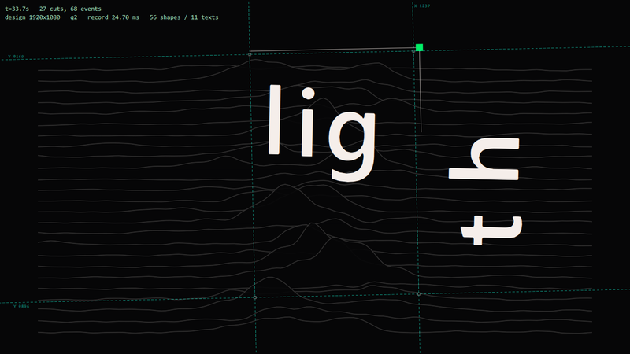

# JIZURA 文字PV — QueMusic 歌词界面

把整首歌词自动编排成一段文字 PV，跑在沉浸播放页里。

- **编排层**：原版 [JIZURA](https://github.com/hakoniwa/JIZURA)（MIT）的引擎 —— planner、24 套风格、
  104 版式、53 入场、47 出场、60 装饰、62 背景图形、20 转场 —— **一行未改**，在 Qt 的 JS 引擎里运行。
- **渲染层**：Canvas2D → 显示列表记录器把 JIZURA 的绘制调用变成矢量路径与文字指令，由 **QtQuick.Shapes** 逐帧绘制。
- 宿主侧只需要标准歌词插件契约。



---

## 安装

**内置主题（默认）** —— 本目录已被 `CMakeLists.txt` 收进 app 的 QML 模块：

```cmake
file(GLOB LYRICS_JIZURA_QML ... "plugins/lyrics/jizura/jizura.qml" "plugins/lyrics/jizura/qml/*.qml")
file(GLOB LYRICS_JIZURA_JS  ... "plugins/lyrics/jizura/js/*.js")
```

它们进的是 `QML_FILES` 而非 `RESOURCES`：只有这样 `qmlcachegen` 才会在构建期把 QML 连同
**1.2 MB 的 JS 库**一起编译成字节码嵌进二进制（`jizura.bundle_js.cpp` ≈ 8.8 MB，exe 增大 ≈ 2.8 MB），
运行时不需要再编译 JS。主题在 `cpp/plugins/LyricsPluginStore.cpp` 的 `builtins()` 注册，名为「JIZURA 文字PV」。

**外置插件** —— 同一份文件复制到 `%APPDATA%\BroNekoX\QueMusic\plugins\lyrics\jizura` 也可用
（需要 `info.json`）。代价是运行时现场编译那 1.2 MB 库，启动要慢约一秒。

需要 **Qt 6.10+**。

---

## 它是怎么工作的

```
歌词           ① 编排层：JIZURA 原版 JS（未修改）
{time,text}      J.plan(project) → plan{cuts, layouts, decor, cam, trans, schemes, events}
                            │ 每帧：plan + t
                ② 记录层：Canvas2D → 显示列表（src/runtime/10_recorder.js）
                   ctx.fillRect/arc/fillText… → 5 个图层的 op 列表
                   · 路径烘焙进设计坐标，裁剪/合并/排序不必再算矩阵
                   · 连续同风格图元合并成一条 ShapePath
                   · 逐字 fillText 合并成整行一个 Text（字距 → letterSpacing）
                            │ op.svg / op.t / op.m
                ③ 渲染层：QtQuick.Shapes（qml/JzStage.qml + qml/JzLayer.qml）
                   5 个合成层 = 背景图形+背景装饰 / 文字下矢量 / 文字 / 文字上矢量 / 前景装饰+HUD
                   每层按需增长的 Shape 池 + Text 池，逐帧只改属性
```

**为什么用记录器而不是把版式重写成 QML**：JIZURA 有 800+ 个部件，手工重写等于重做一个项目；
而它的画面几乎全是矢量的，记录 Canvas2D 调用流交给 Shapes 画，就能原样复用全部内容。

**为什么是 5 个合成层**：Shapes 无法在运行时改 z 序，于是按 JIZURA 自己的绘制阶段分到 5 个固定容器，
顺序天然正确。

---

## 目录

```
jizura/
├── info.json / info.png        插件清单与预览图（外置安装用）
├── jizura.qml                  入口：宿主契约 + 播放时钟 + 自适应画质
├── qml/
│   ├── JzStage.qml             舞台：5 个合成层 + 缩放（cover/fit）
│   ├── JzLayer.qml             单层：Shape 池 / 渐变池 / Text 池
│   ├── JzMetrics.qml           用 Qt FontMetrics 提供字宽与行高
│   └── JzOptions.qml           「播放器样式」里的设置区（不引用插件实例）
├── js/
│   ├── jizura.bundle.js        【生成物】JIZURA 原版 + 移植运行时
│   └── labels.js               风格的键、中文名与说明
├── src/
│   ├── runtime/                移植运行时
│   │   ├── 00_prelude.js       图层模型 + op/文本预算
│   │   ├── 10_recorder.js      ★ Canvas2D → 显示列表记录器
│   │   ├── 20_dom.js           window/document/ES2019 polyfill
│   │   ├── 30_fonts.js         字体目录与度量（替代原版 02_fonts.js）
│   │   └── 40_bridge.js        图层路由、效果裁剪、对 QML 的 API
│   └── config/packs.json       bundle 包含哪些 JIZURA 源文件
├── tools/
│   ├── build_bundle.py         生成 js/jizura.bundle.js
│   ├── svg_preview.js          Node 下跑引擎导出 SVG（不需要 Qt）
│   ├── scan_errors.js          多随机种子扫描，列出 pack 报错与调用栈
│   └── analyze_dump.py         把崩溃转储的偏移解析成函数名
└── tests/
    ├── harness.qml             假宿主跑真插件：帧时 / 截图 / 面板 / 烧帧
    └── lifecycle.qml           照抄宿主的加载接线，反复装卸以验证析构路径
```

---

## 宿主契约

| 注入属性 | 用途 |
| --- | --- |
| `position` / `playing` / `mediaActive` / `playbackRate` | 播放时钟（plan 是绝对时间，seek 不重建） |
| `lyricsModel` | 歌词行 `{time, text, ...}`，`isOther` 与空行跳过 |
| `title` / `artist` | 标题卡与随机种子来源 |
| `mainColor` / `secondColor` / `thirdColor` | 「跟随封面配色」时作为 accent 与色差重影色 |
| `lyricSize` | 与「整体缩放」一起微调构图 |
| `hideHeight` / `lyricMove` / `openTranslate` / `translateModel` | 声明但当前不参与构图 |
| `requestStyle` | 未使用（不写宿主的 `Style`） |

另外实现 `function timerFunction()`（宿主每 320 ms 调用，只做一次廉价的「要不要重排」判断，
动画由 `FrameAnimation` 驱动）与 `property Component styleOptions`。

**只有换歌或改设置才重新编排**；同一首歌内 seek、暂停、快进都不会重建 plan。
编排做了 220 ms 防抖：宿主注入的歌词与设置是分批到达的，过去会在头两帧里连做三次完整编排。

---

## 设置项

| 项 | 说明 |
| --- | --- |
| 风格 | 24 套风格，决定配色、字体族、质感、装饰倾向；名称与说明由 `js/labels.js` 提供中文 |
| 画质 | `自动`（按帧时升降，默认）/ `全部效果` / `无转场·无色差` / `仅歌词` / `调试信息` |
| 图形后端 | `Geometry`（Qt 默认，CPU 三角化）/ `Curve`（GPU 细分）。两者耗时相同，出问题时先切这一项 |
| 随机种子 | 固定 / 每首歌一致（默认）/ 每次播放都不同 |
| 跟随封面配色 | 用封面三主色替换 accent 与色差重影色，背景仍用风格自带配色 |
| 统一感 | 同一段落复用同一套版式与配色，加转场形变 |
| 文字整列 | 假名收紧、助词变小、首字放大、中英间距 |
| 动感 / 故障感 / 色差 / 装饰量 / 切镜密度 | 直接写进 `project.fx` |
| 整体缩放 | 在 cover 缩放之上再乘一个系数（0.85–1.2） |

设置存在宿主设置的 `[JizuraLyrics]` 段。**面板与插件之间没有对象引用**：两边各自读写这份设置，
插件每 250 ms 拉一次自己的副本。这样面板（宿主所有）和插件谁先销毁都不会访问到野对象。

---

## 性能

1280×720 舞台、8 行歌词、约 32 s 曲子实测（`qml tests/harness.qml -- --run 25 --quality auto`）。
数值是「JS 录制 + QML 属性写入」的单帧耗时，**不含 GPU 光栅化**：

| 档位 | 平均 | p50 | p90 | p99 | 峰值 | >16 ms |
| --- | --- | --- | --- | --- | --- | --- |
| 自动（默认） | 6.1 ms | 3 ms | 19 ms | 27 ms | 39 ms | 67 / 605 |
| 全部效果 | 13.9 ms | 9 ms | 31 ms | 54 ms | 60 ms | 218 / 561 |
| 无转场 / 无色差 | 9.7 ms | 5 ms | 26 ms | 32 ms | 39 ms | 159 / 605 |
| 仅歌词 | 2.5 ms | 1 ms | 7 ms | 13 ms | 18 ms | 2 / 624 |

> harness 以 4 倍速推进播放位置，单位墙钟跨越的切镜数是真实播放的 4 倍，超时帧比例也被放大约 4 倍。
> 1× 播放时「自动」档大致只有约 3% 的帧超过 16 ms。

单帧显示列表规模（全曲扫描）：平均 **15 条路径 / 33 个文本**，峰值 **76 / 204**。
同一份内容在 Node 里只要 1.5 ms，说明时间主要花在 Qt 的 JS 引擎上而不是算法本身 ——
所以优化方向是**减少工作量**：

1. **逐字合并成整行**：一行歌词通常只要 1 个 Text，字距用 `font.letterSpacing` 还原；
   字距不一致的排版自动退回逐字。
2. **同风格路径合并**：网格的 16 条线、点阵的 36 个圆各变成一条 ShapePath，峰值路径 364 → 76。
3. **文本排版缓存** 与 **字宽查询缓存**（不再每次重拼字体串）。
4. **离屏画布按轮次清空**：包体缓存的画布若不清空会逐帧累积绘制指令（见 `__touch`）。
5. **op 对象按表面回收**：嵌套帧每帧零分配，把 GC 排除在热路径之外。
6. **op / 文本预算**：转场用 `drawImage` 重放整帧时超出预算就少打几次采样。
7. **自适应画质**：q0 全部 → q1 去色差重影 → q2 去转场与后期 → q3 去背景图形 → q4 只留歌词。

---

## 能力矩阵

**完整支持**：全部矢量图元（矩形、折线、圆/弧、二三次贝塞尔、圆角矩形、多边形、blob）；
文本（逐字定位、旋转/斜切/缩放、字距、行距、竖直排版、描边、逐字回调）；
实心填充与线性/径向渐变；**矩形裁剪**（`bands`/`vbands`/`clip`/`clipY`/wipe，切片与故障类的核心）；
虚线、lineCap/lineJoin、`save/restore` 与完整变换栈、`Path2D`；相机运动、20 种转场、
入场/出场/保持、背景图形、装饰；色差重影。

**近似 / 降级**

| 能力 | 处理 |
| --- | --- |
| `ctx.filter` 模糊 | 记录但不应用（模糊入场变硬切） |
| `shadowBlur` | 偏移副本近似，无模糊 |
| `multiply` / `screen` / `overlay` | 当 `source-over` |
| `difference` / `saturation` / `copy` / `destination-in` | 丢弃该图元 |
| 图案填充 | 取纯色 |
| 字形分解（碎裂、爆散） | 一个字符当一个整块（原引擎缺字形时的退化路径） |
| 非矩形裁剪（`clipFn` 多边形） | 退化为包围盒 |

**不支持**（加载时从抽取表移除，planner 不会再选到）：逐像素后期（slice/block/mosaic/zoom/invert 等，
保留 `chroma`、`shake`、`flash`）、`getImageData`/`putImageData`（空实现）、HUD 角标
（会与宿主顶栏重叠，强制 `off`）。被裁掉的效果可在运行时用 `Jz.JZB.JZ.prunedEffects()` 读到。

---

## 维护

```bash
python tools/build_bundle.py --tier recommended   # 重新生成 js/jizura.bundle.js
node tools/svg_preview.js --sweep 400             # 无 Qt 自检：能排、能画、不报错
node tools/scan_errors.js --seeds 40              # 多随机种子扫 pack 报错（可做发布门禁）
qml tests/harness.qml -- --run 20                 # 有 Qt 自检：真实渲染与帧时
```

原项目只被读取。`build_bundle.py` 按 JIZURA 自己的加载顺序拼接源文件、插入移植运行时、
写 `.pragma library` 头与 MIT 声明。

**被替换的源文件**（`src/config/packs.json` 的 `core_excluded`）：

| 文件 | 原因 |
| --- | --- |
| `02_fonts.js` | 用了 `async/await`，Qt 的 JS 引擎连解析都做不到；由 `src/runtime/30_fonts.js` 用 Qt 字体引擎实现同样的 API |
| `10_audio.js` | 浏览器 `AudioContext` + IndexedDB；节拍由宿主提供 |
| `11_export.js` | WebCodecs MP4 导出 |
| `12_ui.js` | 浏览器编辑器界面 |

**包体档位**（`src/config/packs.json` 的 `tiers`）：

- `core`：只有引擎自带内容，bundle ≈ 314 KB
- `recommended`（默认）：+ 12 个 pack ≈ 1.2 MB → 104 版式 / 60 装饰 / 24 风格
- `full`：全部 24 个 pack ≈ 2.1 MB → 184 版式 / 130 装饰 / 27 风格

**字体**：`src/runtime/30_fonts.js` 的 `STACKS` 按语言与角色列出候选字体，运行时取第一个已安装的；
把想固定的字体挪到最前即可。中文走 `zh-Hans`/`zh-Hant`（微软雅黑 / 微软正黑），
日文走 `Noto Sans JP` → `Yu Gothic UI` → `Meiryo`。

### 测试工具

- `node tools/svg_preview.js --frames 8 --step 2.2`：导出 SVG，不开 Qt 也能看构图
- `node tools/svg_preview.js --sweep 420`：全曲扫描，报告路径/文本数量与耗时峰值
- `qml tests/harness.qml`：假宿主跑真插件，左下角是帧时与画质诊断
- `qml tests/harness.qml -- --run 25`：只测性能
- `qml tests/harness.qml -- --grab 8 --out tests/out`：截图；`--panel` 顺手把设置区也实例化
- `qml tests/harness.qml -- --burn 12000`：一次紧密循环烧 12000 帧
- `qml tests/lifecycle.qml -- --passes 10 --pattern pageDlgClose`：照抄宿主接线反复装卸
- `python tools/analyze_dump.py <转储.dmp>`：把崩溃偏移换成函数名与调用栈

---

## 稳定性

这个移植让 Qt 的 JS 引擎（V4）和 QtQuick.Shapes 都跑在它们平时不常遇到的负载上，
所以排查路径记在这里，下次不必重新摸索。

**先看崩溃落在哪个模块。** 转储在 `%LOCALAPPDATA%\CrashDumps`，WER 报告在
`%ProgramData%\Microsoft\Windows\WER\ReportArchive\AppCrash_QueMusic.exe_*`；
报告里 `Sig[3]` 是模块、`Sig[6]` 是异常码、`Sig[7]` 是模块内偏移。
`python tools/analyze_dump.py` 会把偏移解析成函数名并扫出调用栈：

```
RVA 0x1d86c4  →  QV4::Value::sameValueZero        ← V4 的 Map/属性表键比较
RVA 0x1e8c6d  →  QV4::MemoryManager 相关
```

崩在这类 V4 内部位置，意味着**堆已经被前面的操作破坏**，那里只是受害者；
要顺着调用栈往上找插件向 Qt 写入的可疑值，而不是怀疑内存不足。

### 踩过并修掉的坑

- **`id: layer` 与 `Item` 自带的 `layer` 分组属性撞名**，而属性优先于 id。委托里
  `layer.designW` 取到的是 `Item.layer` 上的 undefined，于是每个 Shape 的宽高一直是 **0×0**
  （却仍在画真实路径），`preferredRendererType` 每帧被赋非法枚举值。**给 id 起名前先查 Qt 有没有同名属性。**
- **诊断用全局注册表必须默认关闭**：库脚本活到引擎结束，而插件实例每次开页都新建销毁，
  `JZB.allFrames` 这类数组会把历次实例的整份绘制指令留在 JS 堆里（现由 `JZB.trackFrames` 默认关闭）。
- **`clearRect` 必须真的清空显示列表**，否则包体缓存的离屏画布会逐帧累积指令。
- **缓存都要有上限**：颜色缓存（键里含连续 alpha）、排版缓存、op/文本预算。
- **不要用 `xform[0].matrix = Qt.matrix4x4(...)` 写 list 里的值类型**（本插件唯一一处 JS 写引擎自管内存
  的地方），改用 `Rotation` + `Scale` 这类普通 QObject 属性。
- **析构时主动断开对 QML 对象的引用**（`J.metrics.setProvider(null)`），否则库脚本会一直握着已销毁的 QObject。
- **不要给设置面板传插件对象**：面板归宿主所有，可能在插件销毁之后仍然存活，
  去读 `plugin.xxx` 就是野指针访问。现在两边只通过设置文件通信。
- **切换 Shape 后端要有序**：先把池子里的路径清空，再改 `preferredRendererType`，
  否则会在每个 Shape 还带着几何数据时重建它的渲染器。
- **编排要防抖**：宿主分批注入歌词与设置、页面开启动画又在改尺寸，
  不防抖会在头两帧里连做三次完整编排，那是启动时最大的一次分配尖峰。

### 省时间的判据

- `node tools/scan_errors.js` / `svg_preview.js` 完全不碰 Qt，两处干净就说明问题不在 JS 逻辑。
- 崩溃与「加载/卸载」绑定还是与「渲染」绑定，用 `tests/lifecycle.qml`（反复装卸）和
  `tests/harness.qml -- --run`（只播放）分别跑就能区分。
- `QV4_FORCE_INTERPRETER=1` / `QV4_MM_AGGRESSIVE_GC=1` / `QV4_GC_TIMELIMIT` 是 Qt 自带开关，
  用来区分「V4 的问题」还是「插件的问题」。
- `QML_DISABLE_DISK_CACHE=1`：排查时务必加上。`qml.exe` 会把编译结果写进
  `%LOCALAPPDATA%\QtProject\Qml Runtime\cache\qmlcache`（含 JS 库的 `.jsc` 字节码），
  不清掉就可能一直在跑旧版本的编译产物，让复现结果随机跳动。

---

## 已知限制

1. V4 比浏览器 V8 慢约 6–10 倍，所以同一份内容在浏览器里能 24 fps 离线渲染，
   这里要靠自适应降档才能稳 60 fps。
2. 非矩形裁剪只按包围盒近似；逐像素后期效果不可用。
3. JIZURA 的逐字时间轴不在 plan 数据模型里 —— 逐字效果由入场进度 `charFn` 与节拍驱动，
   本插件保持同样行为，不消费宿主的 `info`。
4. 窗口尺寸变化会按新宽高比重新编排（只有 7 种预设画幅）；舞台用 cover 缩放，
   比例不同时是裁切而非拉伸。

---

## 许可

本目录的移植层（`src/runtime/`、`qml/`、`jizura.qml`、`tools/`、`tests/`）以 **MIT** 授权。

`js/jizura.bundle.js` 内含 JIZURA 原始代码，按原项目要求随生成物一同保留其版权与许可声明：

```
MIT License
Copyright (c) 2026 hakoniwa
```

完整声明（含原项目未随本移植分发的 mp4-muxer 与字体说明）见 [THIRD_PARTY_NOTICES.md](THIRD_PARTY_NOTICES.md)。
本插件不内嵌、不分发任何字体文件，可用字体取决于系统安装情况。
